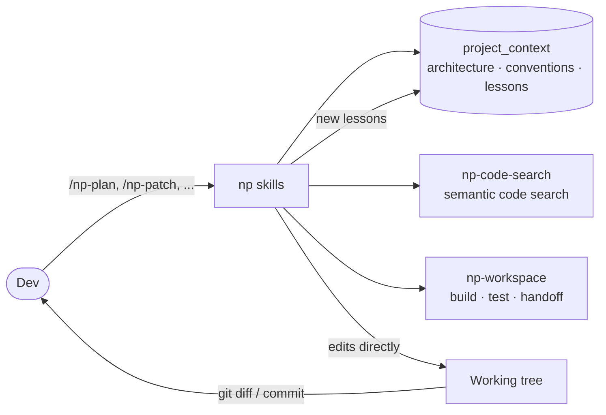
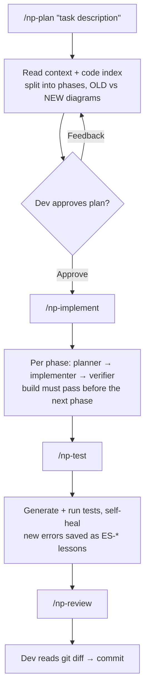
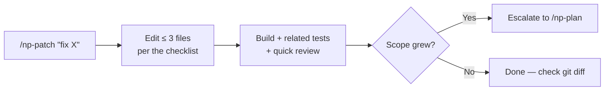

# np harness — quick guide

*[Tiếng Việt](README.vi.md)*

np is a set of Claude Code commands and skills that generate code **following
this repo's architecture and conventions**. Everything lives in the repo
(`.claude/` + `.mcp.json`) — pull and use.

## 1. Setup (once per machine)

Prerequisites: **Python 3.11+** and **Git for Windows** (provides `bash`).

Just open Claude Code in the repo — a startup hook runs `.claude/setup-np.sh`
in the background (installs `cocoindex-code` + a local embedding model; it
downloads PyTorch, so it takes a few minutes). Log:
`~/.np-poc-data/auto-setup.log`. To run it by hand:

```bash
bash .claude/setup-np.sh
```

> **Do not run `/np-init`** — the project is already initialized.

Check: type `/mcp` in Claude Code; `np-workspace` and `np-code-search` must be
connected.

## 2. The big picture



- **project_context** (`.claude/project_context/`): the repo's "brain", committed.
  - `architecture.md` — mandatory architectural constraints.
  - `conventions.md` — coding rules (B*, P*, FB*, FE*) + the Pre-Write Checklist.
  - `stack.md`, `modules.json` — build/test commands, reference modules.
  - `business/` — domain knowledge; `lessons/` — lessons learned along the way.
- **Code index** (`.cocoindex_code/`, not committed): each machine rebuilds it when a session opens.
- **Run state** (`.np-runs/`, not committed): plans, handoffs and reports of each run.
- Code is always edited **directly in the working tree** — review with `git diff`, commit yourself.

## 3. Workflows

### Feature / larger change: plan → implement → test → review



### Small fix: `/np-patch`



### The whole chain with approval gates: `/np-loop`

`/np-loop "requirement"` clarifies the requirement → plans (saved to `plans/`) →
**waits for approval** → implements → **waits** → tests → **waits** → reviews.
Type `/np-loop advance` to move on, `/np-loop status` to see where it is.

## 4. Commands

| Command | Use when | Example |
|---|---|---|
| `/np-plan` | Starting any non-trivial task; produces a plan to approve | `/np-plan "Add an API to list lessons"` |
| `/np-implement` | After the plan is approved; generates code phase by phase, build-gated | `/np-implement` |
| `/np-test` | Generate and run tests for the change just made | `/np-test` |
| `/np-review` | Multi-agent review (bugs, security, quality, contracts, tests, history) of local changes | `/np-review --min-impact high` |
| `/np-patch` | Small, obvious fixes (a few lines, ≤ 3 files) | `/np-patch "Fix UseAuthentication order in Program.cs"` |
| `/np-loop` | Run the full plan → implement → test → review chain with a gate at each step | `/np-loop "Add the speaking result screen"` |
| `/np-frontend` | Build/change UI from a design (Figma), with screenshot comparison | `/np-frontend "build screen X from <figma url>"` |
| `/np-pr-review` | Review a PR against the repo's conventions | `/np-pr-review 12` |
| `/np-feedback` | Teach it something new / correct a misunderstanding → saved to context | `/np-feedback "lesson status now also has 'archived'"` |
| `/np-reindex` | Code search looks stale/odd, after a big refactor | `/np-reindex` |
| `/np-harmonize` | After updating the harness, or on an `[np-drift]` notice | `/np-harmonize` |
| `/np-init` | Only when the repo structure changes a lot (new service/app). **One person runs it, then commits** | `/np-init` |

## 5. Background skills (no need to call)

| Skill | Purpose |
|---|---|
| `load-context` | Loads the project profile + relevant lessons at task start |
| `conventions` | Reads `conventions.md` and runs the Pre-Write Checklist before writing a file |
| `code-review-conventions` | Checks written code against the conventions, outputs a violations table |
| `np-context` | List / add / supersede lessons (LL-\*), error-solutions (ES-\*), business entries (BC-\*) |
| `codegen-*` | Internal agents of `/np-implement`: planner, implementer, verifier, debater/judge |
| `frontend-*` | Internal agents of `/np-frontend`: image analysis, component generation, verify, visual fix, QA |
| `review-*` (agents) | The 6 reviewers run in parallel by `/np-review` |

## 6. Tips

- The more specific the task (files, behaviour, error conditions), the better the plan.
- np broke a convention? → `/np-feedback "..."` so it does not happen again.
- To change a coding rule, edit `.claude/project_context/conventions.md` (it wins
  over every other instruction), then run `/np-harmonize` to refresh the digest in `CLAUDE.md`.
- Never commit `.np-runs/` or `.cocoindex_code/*` (except `settings.yml`) — already in `.gitignore`.

## 7. Troubleshooting

| Symptom | Fix |
|---|---|
| `/mcp` shows `np-workspace` / `np-code-search` failing | Reopen the session; run `bash .claude/bin/bootstrap.sh --check` |
| Warning "code search is unconfigured" | Setup not finished / failed — see `~/.np-poc-data/auto-setup.log` or run `bash .claude/setup-np.sh` |
| Code search misses new files | `/np-reindex` |
| Web build gate fails on missing packages | `npm install` in `apps/web` |
