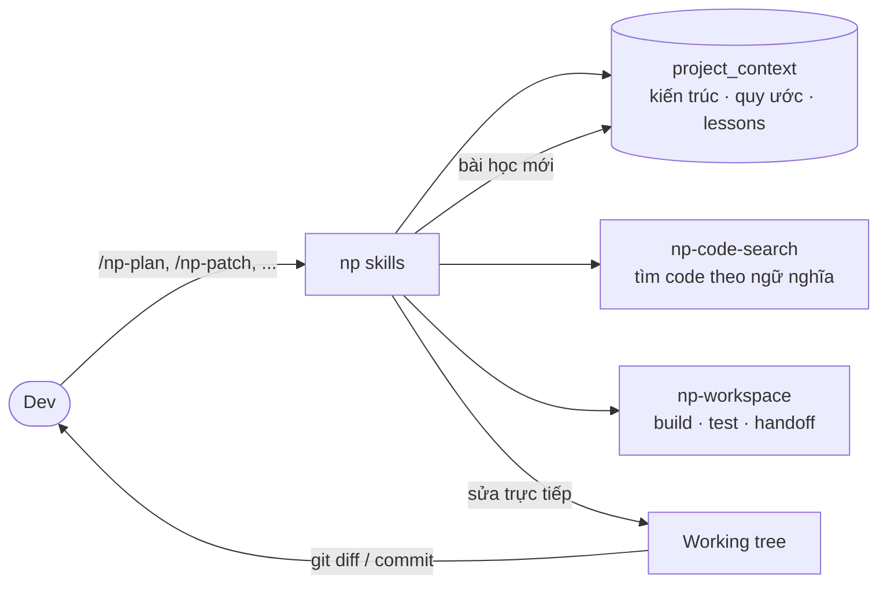
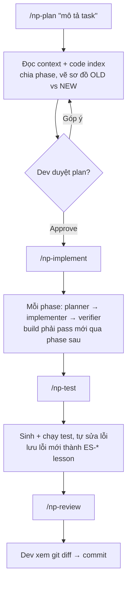
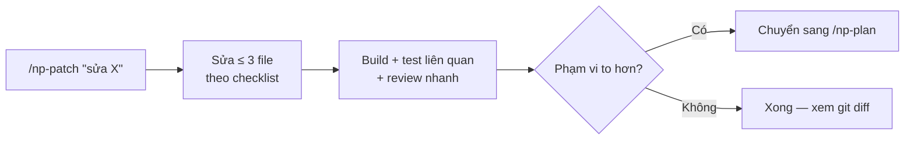

# np harness — hướng dẫn nhanh

*[English](README.md)*

np là bộ lệnh và skill cho Claude Code, giúp sinh code **theo đúng kiến trúc và
quy ước của repo này**. Mọi thứ nằm trong repo (`.claude/` + `.mcp.json`), pull về
là dùng được.

## 1. Cài đặt (mỗi máy, một lần)

Cần sẵn: **Python 3.11+** và **Git for Windows** (có `bash`).

Mở Claude Code trong thư mục repo là xong — hook khởi động tự chạy
`.claude/setup-np.sh` ở chế độ nền (cài `cocoindex-code` + model embedding
local, tải PyTorch nên mất vài phút). Log: `~/.np-poc-data/auto-setup.log`.
Muốn chạy tay:

```bash
bash .claude/setup-np.sh
```

> **Không chạy `/np-init`** — project đã init sẵn.

Kiểm tra: gõ `/mcp` trong Claude Code, phải thấy `np-workspace` và
`np-code-search` ở trạng thái connected.

## 2. Bức tranh tổng thể



- **project_context** (`.claude/project_context/`): "bộ não" của repo, được commit.
  - `architecture.md` — ràng buộc kiến trúc bắt buộc.
  - `conventions.md` — quy tắc code (B*, P*, FB*, FE*) + Pre-Write Checklist.
  - `stack.md`, `modules.json` — lệnh build/test, module tham chiếu.
  - `business/` — kiến thức nghiệp vụ; `lessons/` — bài học rút ra khi làm.
- **Code index** (`.cocoindex_code/`, không commit): mỗi máy tự build lại khi mở session.
- **Run state** (`.np-runs/`, không commit): plan, handoff, report của từng lần chạy.
- Code luôn được sửa **trực tiếp trong working tree** — review bằng `git diff`, tự commit.

## 3. Luồng làm việc

### Tính năng / thay đổi lớn: plan → implement → test → review



### Sửa nhỏ: `/np-patch`



### Chạy cả chuỗi có cổng duyệt: `/np-loop`

`/np-loop "yêu cầu"` hỏi làm rõ yêu cầu → plan (lưu vào `plans/`) → **dừng chờ
duyệt** → implement → **dừng** → test → **dừng** → review. Gõ
`/np-loop advance` để qua bước tiếp, `/np-loop status` để xem đang ở đâu.

## 4. Các lệnh

| Lệnh | Dùng khi | Ví dụ |
|---|---|---|
| `/np-plan` | Bắt đầu task không tầm thường; ra plan để duyệt | `/np-plan "Thêm API lấy danh sách lesson"` |
| `/np-implement` | Sau khi duyệt plan; sinh code theo từng phase, build-gated | `/np-implement` |
| `/np-test` | Sinh và chạy test cho thay đổi vừa làm | `/np-test` |
| `/np-review` | Review đa agent (bug, bảo mật, chất lượng, contract, test, lịch sử) cho thay đổi local | `/np-review --min-impact high` |
| `/np-patch` | Sửa nhỏ, rõ ràng (vài dòng, ≤ 3 file) | `/np-patch "Sửa thứ tự UseAuthentication trong Program.cs"` |
| `/np-loop` | Muốn đi trọn chuỗi plan → implement → test → review có duyệt từng bước | `/np-loop "Thêm màn hình kết quả luyện nói"` |
| `/np-frontend` | Dựng/sửa UI từ thiết kế (Figma), có so ảnh chụp | `/np-frontend "dựng màn X từ <figma url>"` |
| `/np-pr-review` | Review một PR theo quy ước repo | `/np-pr-review 12` |
| `/np-feedback` | Dạy nó điều mới / sửa hiểu sai → ghi vào context | `/np-feedback "lesson status giờ thêm giá trị 'archived'"` |
| `/np-reindex` | Kết quả tìm code cũ/lạ, sau refactor lớn | `/np-reindex` |
| `/np-harmonize` | Sau khi cập nhật harness, hoặc khi thấy thông báo `[np-drift]` | `/np-harmonize` |
| `/np-init` | Chỉ khi cấu trúc repo đổi lớn (thêm service/app). **Một người chạy rồi commit** | `/np-init` |

## 5. Skill chạy ngầm (không cần gọi)

| Skill | Công dụng |
|---|---|
| `load-context` | Nạp profile project + lessons liên quan khi bắt đầu task |
| `conventions` | Đọc `conventions.md` và chạy Pre-Write Checklist trước khi ghi file |
| `code-review-conventions` | Soi code đã viết theo quy ước, xuất bảng vi phạm |
| `np-context` | Xem / thêm / thay thế lesson (LL-\*), error-solution (ES-\*), business (BC-\*) |
| `codegen-*` | Agent nội bộ của `/np-implement`: planner, implementer, verifier, debater/judge |
| `frontend-*` | Agent nội bộ của `/np-frontend`: phân tích ảnh, sinh component, verify, fix visual, QA |
| `review-*` (agents) | 6 reviewer chạy song song trong `/np-review` |

## 6. Mẹo

- Mô tả task càng cụ thể (file, hành vi, điều kiện lỗi) thì plan càng sát.
- Thấy np làm sai quy ước → `/np-feedback "..."` để lần sau không lặp lại.
- Sửa quy tắc code → sửa `.claude/project_context/conventions.md` (file này thắng
  mọi chỉ dẫn khác), rồi `/np-harmonize` để cập nhật bản tóm tắt trong `CLAUDE.md`.
- Không commit: `.np-runs/`, `.cocoindex_code/*` (trừ `settings.yml`) — đã có trong `.gitignore`.

## 7. Gỡ lỗi nhanh

| Triệu chứng | Cách xử lý |
|---|---|
| `/mcp` báo `np-workspace` / `np-code-search` lỗi | Mở lại session; chạy `bash .claude/bin/bootstrap.sh --check` |
| Cảnh báo "code search is unconfigured" | Setup chưa xong / lỗi — xem `~/.np-poc-data/auto-setup.log` hoặc chạy `bash .claude/setup-np.sh` |
| Tìm code không ra file mới | `/np-reindex` |
| Build gate fail ở web vì thiếu package | `npm install` trong `apps/web` |
