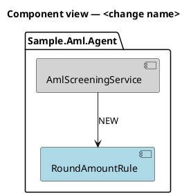

# np-plan — Planning Loop with Dev Review Gate

You drive the planning half of the codegen pipeline: turn a dev request into a reviewed, approved phase plan, and feed the dev's review comments back into project context. No implementation happens here — that is `/np-implement`.

## Step 0 — Preflight

1. Confirm `.claude/np.config.json` exists (walk up from cwd). If absent, stop: "np not initialized — run /np-init".
2. Read it. You need `harness.runs_root` (default `.np-runs`) and `harness.handoff_dirname` (default `.codegen-handoff`). The directory containing `np.config.json` is the **project root and change boundary** — in a monorepo it may be a single micro-service folder; plan only changes inside it (anything outside is read-only reference, and a request that requires editing outside the boundary must say so in the plan review so the dev can decide).

## Step 0.5 — Model choice (ASK before planning)

Planning quality is the whole point of the review gate, so let the dev pick the
tier. Ask (see the **Human gate** protocol below):

> **Which model should produce the plan?**
> - **Opus (latest) — recommended.** Deepest reasoning: better C4 decomposition,
>   sharper duplication/performance analysis, fewer missed call-sites.
> - **Sonnet (latest).** Faster and cheaper; fine for small, well-scoped changes.

Use the **aliases** `opus` / `sonnet` (they always resolve to the current latest
version of that tier). Default the question to `np.config.json` → `models.plan`
when set. After the answer:

- Pass `model: "<choice>"` to **every** agent you spawn with the Task tool in
  this run (orchestrator, planner, debaters, judge) — it overrides their
  frontmatter default. **If your host has no per-spawn model parameter**
  (sub-agents inherit the session model), do not silently pretend: say in one
  line that the chosen tier could not be applied per spawn and that the dev
  should switch it in the host's model selector before continuing. Record the
  choice either way — it still travels in `np.config.json` and
  `00-request.json` to hosts that can honor it.
- Write the choice back to `np.config.json` → `models.plan`.
- You cannot change the main session's own model; if the dev wants the session
  itself on that tier, say so plainly and let them run `/model` and re-invoke.
- Record it in `00-request.json` as `"model": "<choice>"` so `/np-implement`
  can show what planned the run.

### Human gate — how to ask, and when not to

This protocol governs **every** dev-facing question in this skill.

**How:** use the `AskUserQuestion` tool when it is available. When it is not,
ask in prose instead — one question, options as a numbered list, the
recommended one marked `(recommended)` — then **END YOUR TURN and wait**.
**Never treat a missing tool as permission to skip the gate.**

**When not to:** skip the gate ONLY when the run is genuinely non-interactive,
i.e. ANY of:
- the session context contains `[np-noninteractive]`;
- `np.config.json` → `harness.interactive` is `false`;
- the invocation text already answers the question (a named model, a named
  scope) — honor it and never re-ask.

Then take the `np.config.json` default immediately, say in ONE line which
default you used and that the prompt was skipped, and carry straight on. A
phase that stops here has failed, not paused.


## Step 1 — Intake the request

The Skill args carry either a free-text request, a ticket reference (issue number, ticket URL, or a path to a spec file), **or a run id / run dir of an existing np-plan run to resume**.

- **Resume** (args look like a run id `<YYYYMMDD-HHMMSS>-<slug>` or a path under `{runs_root}/` whose handoff dir contains `00-request.json`): reuse that run — `handoff_dir = {runs_root}/{run_id}/{handoff_dirname}`. Do NOT mint a new run id or create new dirs. Read the existing `00-request.json`, `01-phases.json`, `01-plan-review.md`, `01-review-feedback.json` (if present), **and every `01-review-feedback-r*.json` round archive** — the gate file only holds the latest round; the `-r<N>` archives are the record of all earlier rounds and feed the approval-time conversion in Step 7. Then skip Steps 3–5 and re-enter the loop at Step 6 (present the latest plan revision).
- **Escalated patch run** (the resolved handoff dir has a `00-request.json` with `"kind": "patch"` and **no** `01-phases.json`): treat as fresh intake **reusing that run dir** — skip Step 3 (no new run id, no new dirs). Use the original `request` text plus `patch-result.json`'s `escalation_reason` and files-touched list as intake context, rewrite `00-request.json` to this skill's Step 4 shape (keep the original `baseline_commit`, `run_dir`, and `preexisting_dirty`; drop `kind`), and continue at Step 1.5. The cached `00-context.json` frame and any findings already recorded in the dir are reused as-is.
- Free text → use it as-is.
- GitHub issue number/URL → `gh issue view <n> --json title,body` and use title + body.
- File path → Read the file.
- Ticket in another tracker → fetch via its available tool; if none, ask the dev to paste the content.

If, after intake, the request does not name (or clearly imply) a target module/project or the expected behavior, ask the dev up to 3 focused questions (target module? new module or change to existing? messaging/HTTP surface involved?). Do not guess a target module.

## Step 1.5 — Classify the task (`backend` | `frontend` | `fullstack`)

Classify the intaken request; the classification drives Step 5 routing and is recorded in `00-request.json` (Step 4):

- **`frontend`** — the request contains a Figma / `figma.com` URL or names design frames; it is about UI, screens, pages, components, forms, dashboards, or styling; OR the only affected stack (match the request's paths/modules against `np.config.json` `stacks[].roots`) is a **frontend stack** — a stack whose `kind` matches `react*|vue|svelte|angular`, or any stack that declares a `typecheck` command.
- **`fullstack`** — the request names BOTH an API/endpoint/service/backend change AND a UI change (e.g. "add the refund endpoint and the refund screen").
- **`backend`** — everything else (the default).

When genuinely ambiguous (e.g. "add the refund feature" in a repo with both stacks), fold one classification question into Step 1's clarifying questions rather than guessing. On **resume**, read `task_type` from the existing `00-request.json` instead of re-classifying (absent field on an old run → `backend`).

## Step 3 — Create the run

1. `run_id` = `<YYYYMMDD-HHMMSS>-<kebab-slug>` where the slug is ≤ 5 words from the request (e.g. `20260721-142200-add-fx-rate-endpoint`).
2. `run_dir` = `{runs_root}/{run_id}`; `handoff_dir` = `{run_dir}/{handoff_dirname}`. Create both (`mkdir -p`). The run dir holds pipeline state ONLY (handoffs, artifacts, reports) — **all code changes happen directly in the repository working tree**, exactly like normal Claude Code edits; git is the review/rollback mechanism.
3. Record the audit baseline: `baseline_commit` = `git rev-parse HEAD` (null when not a git repo).

## Step 4 — Write the request handoff

```
np_write_handoff(handoff_dir, "00-request.json", {
  "agent": "np-plan",
  "request": "<full request text>",
  "project_name": "<target module/project>",
  "task_type": "backend" | "frontend" | "fullstack",  // from Step 1.5 (additive field; existing readers ignore it)
  "mode": "scaffold" | "continue" | "clone" | ...,   // infer from the request; default "scaffold"
  "run_dir": "<run_dir>",
  "baseline_commit": "<git rev-parse HEAD, or null>",
  "model": "<opus|sonnet from Step 0.5>",
  "review": true
})
```

`review` is **true by default in this skill** — only set false if the dev explicitly asked to skip the review gate (then this skill degenerates to plan-and-report; still show the plan before suggesting implement).

## Step 4.2 — Load context (after the run exists, so the frame gets cached)

Invoke the `load-context` skill with a one-line summary of the task **and the `handoff_dir`**. It loads `np.config.json`, the architecture hard constraints, and active lessons relevant to the task. Keep what it surfaces in mind when reviewing the orchestrator's plan (e.g. a lesson that contradicts a planned approach is worth a review comment).

This runs *after* Step 3/4 deliberately: with a handoff dir in hand, load-context writes the distilled project frame to `00-context.json`, and every later stage of this run (`/np-implement`, `/np-test`) reads that digest instead of re-reading `architecture.md` and `modules.json`. Invoked before the run exists, it would have nowhere to put it.

## Step 4.5 — Effort budget (planning must be proportionate)

A plan is worth minutes, not half an hour. Size the effort to the change and
**tell the orchestrator the budget** in its spawn prompt:

| Change size | Signal | Budget |
|---|---|---|
| **Small** | 1–3 files, one module, no new dependency or contract change | ≤ 6 file reads, ≤ 3 searches, **one phase**, compact contracts, C4 §2.3 only. Target ~3–5 min. |
| **Medium** | 4–10 files, or a new type/endpoint/screen | ≤ 12 file reads, ≤ 6 searches, 1–3 phases. Target ~5–10 min. |
| **Large** | new module, cross-module refactor, migration | reads as needed but say why; phases as needed. Ask the dev before exceeding ~15 min. |

Rules that keep it there:

1. **Search before reading.** One `search` beats five speculative `Read`s — the
   index exists precisely so the planner does not have to browse. Read a file
   only to confirm a specific signature or contract a search surfaced.
2. **Never read the same file twice across agents.** Whatever you (or the
   orchestrator) already read goes into the phase request as facts; sub-agents
   must not re-derive it. If a sub-agent needs a file you already have, quote
   the relevant lines in its prompt instead of making it re-read.
3. **Stop when the contract can be written.** The goal is a plan the dev can
   argue with — not a complete understanding of the module. Once every §3
   contract has its what/params/returns/errors/duplication/perf lines, stop
   exploring.
4. **No plan-time refactor archaeology.** Discovering that some neighbouring
   code is dead or oddly named is a `context_findings` note, not a reason to
   read ten more files.
5. **One reconciliation pass, not many.** If phases disagree on a name or a
   constant, fix it in a single edit round and move on.

If you blow the budget, say so in the summary with what caused it — that is a
finding about the project (or about the harness), not something to hide.

## Step 5 — Produce the plan (route on `task_type`)

### Step 5-BE — `task_type: backend` (unchanged)

Spawn the `codegen-orchestrator` agent (Task tool subagent; fallback: read `.claude/agents/codegen/codegen-orchestrator.md` and inline it as the Task prompt) with these instructions:

> Planning scope ONLY. **Effort budget: <small|medium|large per Step 4.5 — state the read/search caps explicitly>.** Search the index before reading files; never re-read what this prompt already gives you; stop exploring once every contract block can be written. Diagrams are ` ```plantuml ` blocks inside the plan file — never build an HTML page or Artifact. Handoff dir: `<handoff_dir>`. Read `00-request.json` via `np_get_handoff(handoff_dir, "00-request.json")`. Run your context-gathering, module/layout-family detection, and phase decomposition steps, including your Step 3.5 plan-only pass (phase requests + planner only — this is what produces the affected-files list). Write `01-phases.json` and, because `review` is true, write `01-plan-review.md` in the handoff dir (with the Write tool — it is markdown, not JSON) following the **plan-review contract in the calling skill's Step 5.5 exactly**: business summary, C4 diagrams, per-change method contracts with duplication + performance analysis, affected files/modules, affected business context (cite `business/` entry anchors), and the change/impact diagrams. Every section is mandatory and must be concrete — no placeholder nodes, no "TBD" contracts. If any phase comes back `needs_debate: true`, add the `## 9. Decisions` section per your Step 3.5 — that is how the fork reaches the dev. Then STOP at the review gate — do not invoke the implementer, verifier, or debate agents, and do not execute any phase.

Wait for completion; verify `01-phases.json` and `01-plan-review.md` exist (use the Read tool for the `.md` — `np_get_handoff` is for JSON).

**Completeness gate — check before presenting.** `01-plan-review.md` must satisfy the Step 5.5 contract:
- a **Component-level C4 diagram** with NEW/MODIFIED marked, as a ` ```plantuml `
  block (`@startuml`/`@enduml`). **A ` ```mermaid ` block does not satisfy this** —
  if the plan came back with Mermaid, that is a re-spawn, naming the format;
- a **contract block for every new/changed method** listed in the affected-files table — each with *what it does*, parameters, returns, errors, side effects, **duplication check**, and **performance notes**;
- the change/impact diagrams (≥2 non-placeholder ` ```plantuml ` blocks total);
- the **§4 file-budget line** ("New files: N — the same units in `<anchor>` use: M")
  for every phase, and a `Why` entry on every create row. A plan that does not say
  how many files it will add, against what anchor, is incomplete;
- risks/alternatives and open questions (may say "none").

If anything is missing or stubbed with placeholders, re-spawn the orchestrator ONCE naming the exact gaps ("§3 has no contract for `X`; §2.3 diagram missing"). Never present an incomplete plan for approval — the missing part is usually exactly where a duplicate or a performance problem hides.

### Step 5-FE — `task_type: frontend`: produce the UI plan yourself

Frontend planning does NOT run the codegen phase decomposition — do not spawn the codegen-orchestrator. Build a **UI plan**:

1. **Design inputs**: collect the Figma URLs (or other design source — screenshots, textual spec) from the request. If the task clearly needs a design source and none was given, ask the dev.
2. **Frontend context** (fail-open — skip whatever is absent): read `.claude/project_context/architecture.md`'s `## Frontend Architecture` section, `conventions.md`'s `## FE*` rules plus the frontend entries under `## File Placement` / `## Idioms`, and identify the **target app** — the frontend stack's app root the change lands in (the UI is always implemented in the repo's own app, following its existing patterns; the Figma design supplies the visuals). Only when the repo has NO frontend app yet does `np.config.json` → `frontend.template_source` matter (an optional seed for the initial scaffold; empty → scaffold from scratch).
3. **Affected screens/components**: one phase for the whole UI task by default; one phase per screen group only when the request names clearly separable screen groups.
4. **Write the lightweight plan** (`kind` and `frontend` are additive phase keys — backend phases never carry them; a phase without `kind` is backend):

```
np_write_handoff(handoff_dir, "01-phases.json", {
  "agent": "np-plan",
  "task_type": "frontend",
  "phases": [
    { "id": "phase-1", "name": "FRONTEND_UI", "kind": "frontend",
      "goal": "<what UI gets built/changed, one sentence>",
      "validation": "typecheck passes; visual verification against the design frames",
      "frontend": {
        "feature_name": "<kebab-case feature>",
        "screens": [{"label": "<screen/step name>", "desktop_url": "<figma url or null>", "mobile_url": "<figma url or null>"}],
        "design_source": "<figma file/frames | screenshots | textual spec>",
        "template_source": "<resolved frontend.template_source, or ''>",
        "conventions": ["FE1", "..."]   // the FE rule ids from conventions.md that apply
      } }
  ]
})
```

5. **Write `01-plan-review.md` yourself** (Write tool) following the **Step 5.5 contract in full**, with `Revision: N` (starts at 1; you manage the counter for frontend plans). Frontend mapping of the contract: §2.3 Component C4 = the component tree/composition for the screens (NEW vs MODIFIED vs reused-as-is marked); §3 contracts = one block per component/hook, where **props = parameters**, **rendered states = returns** (loading / empty / error / data), side effects = API calls, navigation, storage writes, and the **duplication check asks "does this already exist in the app?"** (cite the existing component path or state that you searched and found none) — this is the section that stops the pipeline re-creating a sidebar it already built; §4 also lists routes added; §5 cites `business/` anchors and FE rule ids; §6 diagrams = OLD-vs-NEW screen/navigation structure plus the end-to-end user flow including the API calls it triggers. Also record **Design source** (the Figma frames/URLs). Same file, same review gate as backend plans.

### Step 5-FS — `task_type: fullstack`: backend phases + appended frontend phase, ONE review

1. Run Step 5-BE (codegen-orchestrator, planning scope) for the backend part of the request.
2. After the orchestrator stops at the review gate, **append the frontend phase**: read `01-phases.json` via `np_get_handoff`, add one final phase shaped exactly like Step 5-FE.4's (id `phase-<N+1>`, `"kind": "frontend"`, with the `frontend` block), and rewrite the file with `np_write_handoff`. Never renumber, reorder, or alter the orchestrator's phases.
3. **Extend `01-plan-review.md`** with a `## Frontend` section carrying Step 5-FE.5's content (screens, design source, conventions), and **extend the `## Change & impact diagrams` section** so it covers both halves (the workflow diagram shows the full path UI → API → backend; the impact summary lists both API and UI effects). Keep the orchestrator's `Revision: N` line untouched — one revision number covers both halves.
4. One review gates both: approval approves API + UI together. On `changes_requested`, route each comment: UI-directed comments you honor yourself (revise the appended phase + `## Frontend` section); backend-directed comments go through the orchestrator re-plan (Step 7). **After ANY orchestrator re-plan you MUST re-append the frontend phase and the `## Frontend` section** — the orchestrator rewrites both files and knows nothing about them.

## Step 5.5 — The plan-review contract (binding for ALL task types)

> **Where this lives matters.** For backend/fullstack runs the file is written by
> the `codegen-orchestrator`, whose own Step 3.5 carries this same contract
> inline — that is the copy it actually follows. Keep the two in sync when you
> change either; a reference from here alone does NOT reach it. You still verify
> the result against the gate below and re-spawn once if a section is missing.

`01-plan-review.md` is what the dev actually reviews, so it must contain enough
for them to catch a wrong approach, a duplicate, or a performance problem
**before** any code is written. Whoever writes it (the orchestrator for backend,
you for frontend, both for fullstack) MUST produce every section below, filled
with real names discovered from the codebase — never placeholders.

```markdown
Revision: N

# <Change title>

## 1. Business summary
<2–5 sentences: what the dev asked for, what will exist afterwards, what stays
the same. Plus the acceptance gate (the exact build/test/typecheck command).>

## 2. C4 view of the change
### 2.1 Context (C1) — only when the change touches a system boundary
<PlantUML: this system + the external actors/systems involved in THIS change.
Skip with one line saying why when the change is purely internal.>
### 2.2 Container (C2) — only when >1 deployable/app is involved
<PlantUML: the containers (services, apps, DBs, queues) the change spans and the
calls between them. Skip with one line when it is single-container.>
### 2.3 Component (C3) — MANDATORY
<PlantUML: the components/classes/modules inside the target that participate,
with NEW and MODIFIED nodes visually marked and existing ones plain. This is the
level the dev checks the design at.>

## 3. Method / API contracts  — MANDATORY, one block per new or changed unit
For every method, function, endpoint, hook, or component being added or changed:

### `<Type.Method(param: T, …) -> R>`  — NEW | MODIFIED
- **File:** `<path>` (create | modify)
- **What it does:** <one sentence, behavioural not restating the name>
- **Parameters:** `<name: type>` — <meaning, valid range, null/empty handling>
- **Returns:** `<type>` — <what each outcome means>
- **Errors / failure modes:** <exceptions thrown or error values returned, and
  the status/UI each maps to>
- **Side effects:** <writes, publishes, cache invalidation, navigation — or
  "none (pure)">
- **Called by:** <existing call sites that will use it — real paths>
- **Duplication check:** <what you searched for and what you found: either
  "searched `<query>` over `<paths>` — no existing equivalent" or "closest
  existing is `<symbol>` at `<path>`; NOT reused because <reason>". A change
  with no duplication check line is incomplete.>
- **Performance / concurrency notes:** <complexity, extra I/O or round-trips,
  N+1 risk, added lock/transaction scope, re-render or bundle impact — or
  "no material change">

## 4. Affected files
<One line per phase, from its `file_budget`: "New files: N — the same units in
`<anchor>` use: M", with the reason for each excess file when N > M, and
`Granularity gate: FAILED — <k> of <N> new files are unjustified` when the
orchestrator's gate could not clear it. This is the line that stops a change
landing as a folder of one-type files — read it before the table.>

| File | Change | Phase | Why |
`Why` carries each create row's `new_file_reason` (`reused:` / `mandated:` /
`readability:`); a create row with none renders `unjustified (B7)`.

Plus an explicit **not changing** list for things a reader would expect to be
touched but which stay as-is (with the reason).

## 5. Affected business context
<Cite `business/` entry anchors (BC-*) this change implements, contradicts, or
should update; and any `lessons/` (LL-*/ES-*) entries that bear on the approach.>

## 6. Change & impact diagrams
<(a) OLD-vs-NEW comparison (PlantUML), (b) end-to-end workflow (PlantUML sequence) with
new/modified steps marked, (c) what-changes / what's-affected bullets:
callers/consumers affected, behaviour that stays identical.>

## 7. Risks & alternatives considered
<Each risk with its mitigation; each rejected alternative with why. This is
where the dev learns what you weighed.>

## 8. Open questions for the dev
<Anything you had to assume. Empty is allowed — say "none" explicitly.>

## 9. Decisions  — only when a phase is decision-flagged; omit the section otherwise
### <the decision_question, verbatim>
<Phase id. One block per alternative: name, what it does, pros, cons,
reversibility, its affected files. Mark one **Recommended** with the reason.
Close with: "If you don't pick, we go with the recommendation.">
```

**Right-sizing:** sections 1, 2.3, 3, 4, 6 are always required. C1/C2 may be
skipped with a stated reason. A trivial one-line change still gets a contract
block — it is short, not absent. **Frontend plans** use the same shape with
components/hooks/props as the "methods" (props table = parameters, rendered
states = returns, and the duplication check asks "does this component already
exist in the app?").

## Step 6 — Present the plan to the dev

Show the dev:

1. `01-plan-review.md` content (verbatim, not paraphrased).
2. A compact table of phases from `01-phases.json` (id, name, goal — plus `kind` when any phase carries one, so the dev sees which phase is the frontend one).
3. Anything from Step 4.2's loaded lessons that conflicts with or reinforces the plan.
4. The diagrams as ` ```plantuml ` blocks **straight from the plan file** — nothing else.

### 6.1 — Diagrams are PlantUML text, never a rendered viewer

Write diagrams as ` ```plantuml ` fenced blocks inside `01-plan-review.md` and show those blocks as-is. **Do NOT build an HTML page, do NOT publish an Artifact, do NOT load the artifact-design skill** — a diagram viewer costs minutes and thousands of tokens and adds nothing the dev cannot get from their IDE (VS Code/JetBrains PlantUML preview renders these blocks natively, and the text stays diffable in git).

Keep the PlantUML minimal and offline-renderable:



- Plain `@startuml/@enduml` with component, sequence or class syntax — laid out at the C4 level being shown. The `C4-PlantUML` `!include` is optional and only if the project already uses it (it needs network at render time).
- Mark NEW/MODIFIED with a colour or a `<<new>>` stereotype and say so in a legend line.
- No styling beyond that. Diagram size: whatever fits the change — a 6-node component diagram is a good plan, a 40-node one is noise.

### 6.2 — Decisions, when the plan has any

If `01-plan-review.md` has a `## Decisions` section, a phase hit a genuine
architectural fork and **the dev picks — no agent panel decides for them**. Show
each decision block as its own question, using `AskUserQuestion` (or numbered
prose where unavailable) with one option
per alternative (recommended one first, labelled `(Recommended)`), the option
description carrying its pros/cons and `reversibility`.

Keep it rare and keep it cheap: these are only raised for forks that are
consequential and expensive to reverse, so there is usually **zero** and
occasionally one. If the dev does not want to engage ("you pick", "whatever you
think"), take the recommendation and move on — never push back or re-ask.

Record every answer, then carry it into the gate file (Step 7) as `decisions[]`.

Then ask for a decision: **approve**, or **request changes** (free text). Prompt them explicitly on the things the contract exists to surface: *does any contract in §3 duplicate something we already have? does any performance note look wrong for your hot paths? is the C4 decomposition where you'd put this?* — that is the feedback the plan is designed to collect.

**When §4 reports `over_budget` or a failed granularity gate, say so in your own words as part of the ask** — "this plan adds N files where a comparable unit in `<anchor>` uses M; <k> of them have no B7 reason" — and name the rows. Approving that revision is the dev's explicit sign-off on those files; the implement stage will not revisit it.

**If the Step 5.5 contract is not fully satisfied (missing C4 component diagram, a changed method without a contract block, missing duplication/performance lines, placeholder nodes), that is an automatic revise — do not offer approve.**

## Step 7 — Feedback loop (max 3 rounds)

**If the dev requests changes:**

1. Structure their feedback into comments: `[{"topic": "<kebab-key>", "comment": "<their point, verbatim where possible>"}]`. One comment per distinct point; pick a topic key that names the subject (e.g. `queue-naming`, `wrong-target-module`).
2. Write the gate file. `revision` = the `Revision: N` value from the `01-plan-review.md` the dev just reviewed — the orchestrator uses it to tell fresh feedback from feedback it already re-planned for:

```
np_write_handoff(handoff_dir, "01-review-feedback.json", {
  "decision": "changes_requested",
  "revision": <N of the reviewed plan>,
  "comments": [{"topic": "...", "comment": "..."}],
  "decisions": [{"phase_id": "phase-2", "chosen": "<approach name>", "source": "dev"}]
})
```

Include `decisions[]` only when Step 6.2 actually asked something; omit the key otherwise. Answers survive a re-plan — carry them into every later round's gate file unless the re-plan removed that phase.

3. Write an **identical archive copy** to `01-review-feedback-r<N>.json` (same content, N = the same revision): `np_write_handoff(handoff_dir, "01-review-feedback-r<N>.json", <same object>)`. The gate file is overwritten every round; the `-r<N>` archives never are — they preserve every round's raw comments for resume (Step 1) and for the approval-time conversion below. The orchestrator and updater keep reading only the gate file.
4. Re-plan, routed by `task_type`:
   - **backend** → re-spawn the `codegen-orchestrator`: "Re-plan. Read `01-review-feedback.json` from `<handoff_dir>`, revise the decomposition to honor every comment, rewrite `01-phases.json` and `01-plan-review.md` with the revision bumped, then stop with `paused_for_review`."
   - **frontend** → revise the UI plan yourself (no orchestrator): honor every comment, rewrite `01-phases.json` and `01-plan-review.md` with `Revision` bumped (Step 5-FE).
   - **fullstack** → if any comment is backend-directed, re-spawn the orchestrator as above, then **re-apply Step 5-FS.2–3** (re-append the frontend phase + `## Frontend` section, folding in any UI-directed comments). If ALL comments are UI-directed, skip the orchestrator: revise the appended phase and `## Frontend` section yourself and bump the `Revision` line.
5. Go back to Step 6 — the revised plan MUST carry refreshed ` ```plantuml ` diagrams reflecting the changes. A revision edits the plan file in place; there is no viewer to rebuild.

After 3 rounds without approval: stop, tell the dev the run state is preserved at `<handoff_dir>` and can be resumed by running `/np-plan <run_id>` again (Step 1's resume path picks up the existing handoff dir and prior rounds' comments), and that the sticking points may need a direct conversation rather than another loop.

**If the dev approves:**

First collect every prior round's comments by reading all `01-review-feedback-r*.json` archives in the handoff dir (in round order) — do NOT rely on conversation memory; after a resume, the archives are the only record of earlier rounds. Then write the final gate file, converting the full review dialogue (all rounds' comments + anything substantive the dev said while approving) into findings:

```
np_write_handoff(handoff_dir, "01-review-feedback.json", {
  "decision": "approved",
  "revision": <N of the approved plan revision>,
  "comments": [ ...every comment from all rounds... ],
  "decisions": [{"phase_id": "phase-2", "chosen": "<approach name>", "source": "dev"}],
  "context_findings": [
    {"topic": "<comment topic>", "kind": "lesson" | "business_context" | "correction",
     "claim": "<the durable rule/fact the comment established>",
     "evidence": ["dev planning-review comment, run <run_id>"],
     "supersedes": null, "confidence": "dev_confirmed"}
  ]
})
```

Conversion rules:

- Only **substantive** comments become findings — ones that state a reusable rule, fact, or correction ("we never expose this service over HTTP", "OttService owns approvals, not WorkflowService", "modules.json lists the wrong build target"). Plan-local remarks ("rename phase 2", "split this phase") get NO finding.
- Kind: coding/architecture guidance → `lesson`; domain/business fact → `business_context`; wrong metadata about a module (family, capabilities, build target, reference module) → `correction`.
- If the comment says an existing documented rule/entry is outdated, set `supersedes` to that entry's id when the dev named it or it is unambiguous from `context_list`; otherwise leave `null` (the updater will match).
- Confidence is always `dev_confirmed` — these came from the dev's own review.

## Step 8 — Context updater: defer by default (contract §8.1)

Findings are **recorded** here, **applied** once at the end of the session by the `context-updater` sub-agent. Planning is almost never the end of the session, so the default is to defer:

- **Deferred (default)** — the dev approved and will implement (they were handed `/np-implement <run_id>`), or you were invoked by `np-loop`, or the args carry `defer_context_update=true`. Do NOT spawn the updater. The findings already live in `01-review-feedback.json`; just say in Step 9 how many are pending and that the later stage applies them. Never call `context_add_entry`/`context_supersede` yourself.
- **Final** — the dev explicitly says this is a plan-only run (planning the work for later, no implement stage coming) or asks for the context to be updated now. Then spawn the `context-updater` agent with args `handoff_dir=<handoff_dir>`, wait, read `context-update-report.json`, and relay the counts.

When in doubt, defer — deferring costs nothing (the next stage's freshness check picks the findings up), while an early run bumps entry dates and can persist knowledge that implementation later contradicts.

## Step 9 — Final summary

Report to the dev:

- run id + handoff dir path,
- the approved phases (one line each),
- context findings: deferred → "N findings recorded, applied at the end of the run"; final-mode → the inserted/updated/superseded counts and ids from `context-update-report.json`,
- next step: `/np-implement <run_id>`.

## DO NOT

- Execute any implementation phase, write source code, or invoke implementer/verifier — planning only. This includes frontend tasks: never invoke `np-frontend`/`frontend-orchestrator` from this skill.
- Spawn the codegen-orchestrator for a `frontend`-only plan — the UI plan is yours to write (Step 5-FE).
- Let an orchestrator re-plan silently drop the fullstack frontend phase — re-append it after every re-plan (Step 5-FS.4).
- Skip the review gate unless the dev explicitly said so — the gate applies identically to backend, frontend, and fullstack plans.
- Fabricate `context_findings` from comments that are plan-local edits rather than reusable knowledge.
- Write context entries yourself (`context_add_entry`, `context_supersede`, edits under `project_context/`), or spawn the updater when an implement stage is still coming — recording findings is this skill's whole job (contract §8.1).
- Set `confidence: observed` on findings from this skill — dev review comments are `dev_confirmed` by definition.
- Paraphrase `01-plan-review.md` instead of showing it.
- Present a plan for approval that does not satisfy the Step 5.5 contract — no C4 component diagram, a new/changed method without its contract block, or contracts missing the duplication-check and performance lines. Those sections are what let the dev catch a duplicate or a hot-path regression before code exists; a plan without them wastes the gate.
- Write a contract block from the method name alone — the "what it does", call sites, and duplication check must come from actually searching the codebase.
- Build an HTML diagram viewer, publish an Artifact, or load the artifact-design skill for a plan — diagrams are ` ```plantuml ` text in the plan file (Step 6.1). A viewer costs minutes and thousands of tokens for something the dev's IDE renders for free.
- Blow the Step 4.5 effort budget silently: browsing twenty files for a three-file change, re-reading what another agent already read, or exploring past the point where the contracts could be written.
